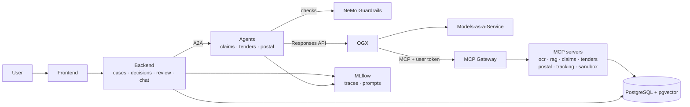

# Agentic Multi-Domain Decision Platform

AI agents that process business cases end to end — read the documents, search the precedents,
compute, decide — and hand the cases they should not decide alone to a person, with a clear brief.
Three business domains share the same platform on **Red Hat OpenShift AI 3.5**:

| Domain | Case | The agent decides | A person decides when the agent says |
|---|---|---|---|
| Insurance claims | claim (CLM-…) | approve / deny | manual_review |
| Construction tenders (BTP) | tender (AO-…) | go / no_go | a_approfondir |
| Postal complaints | complaint (RECL-…) | rembourser / réexpédier / rejeter | escalader |

What the demo shows:

* **Agents** (A2A protocol) that use **MCP tools** through the **OGX** Responses API: vision OCR,
  similarity search on precedents (pgvector), payout computed in an isolated **OpenShell sandbox**.
* **Human in the loop**: a review inbox; for each case the agent's brief (why it did not decide, what
  to check, what it leans to), facts taken from the tools without any model, questions to the agent,
  and a decision that needs a justification when it goes against the agent.
* **Personal data never reaches the model**: NeMo Guardrails on the messages and answers, masking in
  the MCP servers on the tool results.
* **Governance**: OpenShift login, access profiles (OpenShift groups), every tool call checked for the
  user by the **MCP Gateway**.
* **Observability**: one **MLflow** trace per chat turn or processing, agent prompts versioned in the
  MLflow Prompt Registry, metrics dashboard.

## Architecture



How a case is processed, reviewed, and discussed in the chat: [docs/architecture.md](docs/architecture.md).

## Quick start

### Local (podman compose)

The same architecture as on the cluster, without NeMo, SPIFFE and the MCP Gateway; the models are
called on an external MaaS.

```bash
cat > .env <<'ENV'                       # git-ignored
MAAS_BASE_URL=https://<external-maas-host>/v1
MAAS_API_KEY=<your-key>
MAAS_REASONING_MODEL=llama-scout-17b
MAAS_VISION_MODEL=llama-scout-17b
MAAS_EMBEDDING_MODEL=nomic-embed-text-v1-5
MAAS_EMBEDDING_DIMENSION=768
ENV
podman login registry.redhat.io          # the OGX image
podman compose up -d --build
```

Frontend on http://localhost:3000, API on http://localhost:8000/api/v1, MLflow on
http://localhost:5001. The `data-init` service uploads the PDFs, has the precedents read by the OCR
server, saves their decisions and creates the embeddings (`FORCE_REINIT=true podman compose up
data-init` to start again).

### OpenShift AI 3.5

Operators, MaaS, build and Helm install: [RHOAI-3.5-SETUP.md](RHOAI-3.5-SETUP.md).

```bash
helm upgrade --install multi-agents helm/multi-agents -n multi-agents --create-namespace \
  -f helm/multi-agents/values-rhoai35.yaml \
  --set global.clusterDomain=<apps.cluster-domain> \
  --set models.external.host=<external-maas-host> \
  --set secrets.maasExternalApiKey=<key> --set secrets.postgresPassword=<password> ...
```

## Using it

* **Claims / Tenders / Postal**: the cases of the domain; *Process* runs the agent (about a minute),
  the case page shows each tool step, the decision, the evidence and the MLflow trace.
* **Review**: the cases waiting for a person, oldest first.
* **Chat**: ask the agents about cases, tracking, rates; the trace panel shows the routing, the A2A
  task, the guardrails verdicts and the tool calls.
* **Sandbox**: the OpenShell policy in force and isolation scenarios (network and system writes
  denied).
* **Admin**: demo reset, users and their access profiles.

The same through the API (on OpenShift add `-H "Authorization: Bearer $(oc whoami -t)"`):

```bash
B=http://localhost:8000/api/v1
curl "$B/claims/" | jq '[.items[] | select(.status == "pending")][0].id'
curl -X POST "$B/claims/<id>/process"                          # returns at once
curl "$B/claims/<id>" | jq '.status, [.processing_steps[].step_name]'
curl "$B/claims/<id>/decision" | jq '.decision, .agent, .review'
curl "$B/review/inbox" | jq                                   # the cases waiting for a person
curl -X POST "$B/review/claims/<id>/decision" -H 'Content-Type: application/json' \
  -d '{"decision": "approve", "justification": "Invoice received"}'
SESSION=$(curl -s -X POST "$B/chat/sessions" -H 'Content-Type: application/json' -d '{}' | jq -r .session_id)
curl -N -X POST "$B/chat/sessions/$SESSION/messages" -H 'Content-Type: application/json' \
  -d '{"message": "Combien de sinistres sont en attente ?"}'
```

## Repository

| Folder | What |
|---|---|
| `backend/app/` | FastAPI backend: domains, processing, decisions, review, chat, access profiles |
| `backend/mcp_servers/` | the MCP servers (tools) and what they share |
| `agents/` | the A2A agents (one shared executor, one profile file per agent) |
| `frontend/` | React UI |
| `helm/multi-agents/` | the Helm chart, the prompt files, the catalog entries |
| `data-init/` | the job that prepares the data at installation |
| `database/` | schema, seed, precedent decisions |
| `documents/` | the sample PDFs |

Where to change what, and how to add a tool or a domain: [docs/code-guide.md](docs/code-guide.md).

## Documentation

* [docs/architecture.md](docs/architecture.md) — components, processing, human review, chat, personal data, access control
* [docs/code-guide.md](docs/code-guide.md) — code layout, conventions, common changes, tests
* [docs/configuration.md](docs/configuration.md) — models, access profiles, agents, prompts, guardrails, tracing
* [RHOAI-3.5-SETUP.md](RHOAI-3.5-SETUP.md) — installation on OpenShift AI 3.5, verification, known limitations
* [docs/troubleshooting.md](docs/troubleshooting.md)

## Tests

Backend, MCP servers, agents and frontend tests all run in containers; the commands are in
[docs/code-guide.md](docs/code-guide.md#tests).

## License

Apache License 2.0 — see [LICENSE](LICENSE).
