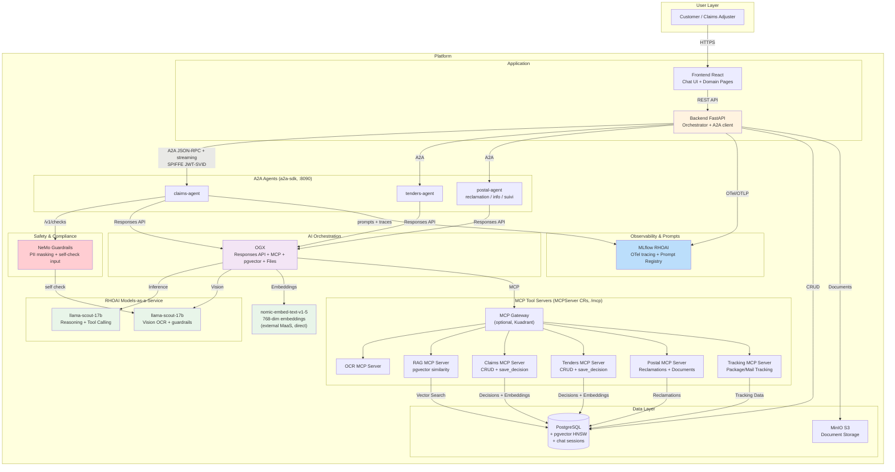

# Agentic Multi-Domain Decision Platform

An intelligent multi-agent decision platform powered by AI agents, demonstrating autonomous decision-making through **ReAct (Reasoning + Acting)** workflows with built-in compliance guardrails. The platform supports **multiple business domains** with a shared agent infrastructure and a **multi-agent orchestrator** that dynamically routes user requests to specialized domain agents:

- **Insurance Claims Processing** — Approve / Deny / Manual Review decisions
- **Tender Management (Appels d'Offres)** — Go / No-Go / Needs Deeper Review decisions for construction (BTP) tenders
- **Postal Mail Processing (Courrier)** — Complaint handling, package tracking, and knowledge base queries
- **Multi-Agent Orchestrator** — Intent-based routing, chat sessions, and cross-domain agent chaining

It runs on **Red Hat OpenShift AI 3.5**: decoupled **A2A** domain agents, **OGX** Responses API with **MCP** tools, **Models-as-a-Service**, **NeMo Guardrails**, **MLflow** tracing + Prompt Registry, and optional **SPIFFE/SPIRE** agent identity.

## Table of Contents

- [Business Overview](#business-overview)
- [Architecture](#architecture)
- [Backend Architecture](docs/backend-architecture.md) — Processing flows, modular design, and how to add a new agent
- [Technology Stack](#technology-stack)
- [Local Development](#local-development)
- [OpenShift Deployment](#openshift-deployment) — see also [RHOAI-3.5-SETUP.md](RHOAI-3.5-SETUP.md)
- [Configuration](#configuration) — models, A2A agents, [access profiles](#access-profiles-openshift-login), prompts
- [NeMo Guardrails](#nemo-guardrails)
- [MLflow Tracing](#mlflow-tracing-opentelemetry)
- [Troubleshooting](#troubleshooting)
- [Known Issues](#known-issues)

---

## Business Overview

### What Problem Does This Solve?

Many business processes require expert analysis of documents, comparison with historical data, and structured decision-making — tasks that are time-consuming and prone to inconsistencies. This platform showcases how AI agents can **autonomously** process these tasks through intelligent reasoning and tool usage, while maintaining human oversight where needed.

### Use Case 1: Insurance Claims Processing

- Autonomous document processing via vision-based OCR (multimodal model, `llama-scout-17b` by default)
- Smart policy matching via semantic search through user contracts
- Precedent-based reasoning using similar historical claims (RAG)
- Decision: **Approve / Deny / Manual Review** with confidence score

### Use Case 2: Tender Management (Appels d'Offres)

- Ingests tender documents (DCE/RFP) and extracts key information via OCR
- Analyzes the tender against the company's past project references, certifications, and historical tender outcomes using RAG similarity search
- Generates a **Go / No-Go / Needs Deeper Review** recommendation with risk analysis, win probability, estimated margin, strengths and weaknesses
- Supports Human-in-the-Loop review when confidence is low

### Use Case 3: Postal Mail Processing (Courrier)

- Handles customer complaints (reclamations) related to postal services (lost packages, damaged mail, delivery delays)
- Tracks package and mail delivery status via the tracking MCP server
- Searches an internal postal knowledge base for regulations, procedures, and precedents
- Generates structured responses with resolution recommendations
- Three specialized profiles of the postal A2A agent:
  - **courrier_reclamation**: Complaint CRUD, document management, decision saving
  - **courrier_suivi**: Real-time package/mail tracking
  - **courrier_info**: Knowledge base search for postal regulations

### The ReAct Agentic Workflow

Instead of rigid, pre-programmed rules, the system uses the **ReAct (Reasoning + Acting)** pattern where an AI agent reasons about what information it needs, calls appropriate tools, observes the results, and repeats until it can make a decision.

Business processing (the **Process** button, `POST /api/v1/<domain>/<id>/process`) runs a **guided workflow** in the agent: one OGX Responses call per tool (`tool_choice: required`, `max_tool_calls: 1`, `parallel_tool_calls: false`, chained by `previous_response_id`), then a final call that analyzes the results, may use the optional tools (knowledge base search) and ends with a JSON decision block. Llama emits Python-like text instead of structured calls when asked for several tools at once, so one tool per call keeps processing reliable; a failed step is retried once, then recorded and the workflow continues.

```
Customer Submits Claim
        |
+-------------------------------------------------------+
|  Guided agent workflow — one tool per OGX call         |
+-------------------------------------------------------+
|  1. ocr_document(claim_number)   -> Extracted text     |
|  2. retrieve_user_info(user_id)  -> Contracts          |
|  3. retrieve_similar_claims()    -> Precedents of the  |
|                                     same type + their  |
|                                     decisions (RAG)    |
|  4. compute_payout(claim_number) -> Coverage + payout, |
|                                     computed in the    |
|                                     OpenShell sandbox  |
|  5. analysis                                           |
+-------------------------------------------------------+
        |
  JSON decision: Approve / Deny / Manual Review
  + confidence + reasoning (no matching contract: Deny)
        |
  Backend saves the decision and embeds the document
  (searchable as a precedent)
```

The endpoint returns at once (`status: processing`) and the job runs in the backend; the UI polls `GET /api/v1/<domain>/<id>/status` (cloud load balancers close requests idle for 60 s). An item left `processing` without a running job (backend restart) can be processed again.

### Multi-Agent Orchestrator

The backend includes a **multi-agent orchestrator** that classifies user intent and dispatches requests to the appropriate **decoupled A2A agent**:

```
User Message
    |
    v
+------------------------------------------+
|  Backend — Multi-Agent Orchestrator      |
|  intent routing + A2A client             |
+------------------------------------------+
    |  A2A JSON-RPC + streaming (:8090)
    |  optional SPIFFE JWT-SVID
    v
+--------------+  +---------------+  +-----------------------------+
| claims-agent |  | tenders-agent |  | postal-agent                |
|              |  |               |  | reclamation / info / suivi  |
+--------------+  +---------------+  +-----------------------------+
    |  NeMo Guardrails on input + output (PII masking, self-check)
    v
+--------------------------------------------------+
|  OGX — Responses API (/v1/responses)             |---> RHOAI MaaS (models)
+--------------------------------------------------+
    |  MCP Streamable HTTP (/mcp), optionally via the MCP Gateway
    v
+--------------------------------------------------+
|              MCP Tool Servers                     |
| OCR | RAG | Claims | Tenders | Postal | Tracking |
| Sandbox (run_python in OpenShell)                |
+--------------------------------------------------+
    |
    v
+------------------------------+  +------------------------------+
|  PostgreSQL + pgvector       |  |  MLflow (RHOAI)              |
|  MinIO S3 (documents)        |  |  traces + Prompt Registry    |
+------------------------------+  +------------------------------+
```

**Key capabilities**:
- **Decoupled A2A agents**: one service per domain (`claims-agent`, `tenders-agent`, `postal-agent`), discovered through their agent card, streaming tool activity and text deltas back to the backend
- **SSE Streaming**: Real-time response streaming via `POST /api/v1/orchestrator/chat/stream` with tool call events, text deltas, and completion notifications
- **Decision persistence**: Agents call `save_claim_decision` / `save_tender_decision` / `save_reclamation_decision` MCP tools to persist decisions, update status, and auto-generate embeddings
- **RAG by precedents**: Similar claims/tenders found via pgvector cosine similarity on OCR text embeddings
- **Semantic routing**: embeddings of the A2A agent card skills pick the agent, one short LLM call breaks ties, keywords as fallback (see [A2A agents](#a2a-agents))
- **Chat sessions**: Persistent conversation history with session management
- **Tool call observability**: Full tool execution traces (name, server, output, error) persisted and displayed in UI
- **Token consumption tracking**: Per-message and per-session LLM token usage displayed in chat
- **Bilingual support**: FR/EN language detection and response generation
- **NeMo Guardrails**: Presidio PII masking on agent input and output (including French identifiers) + LLM self-check on input
- **MLflow**: Distributed tracing via OpenTelemetry and versioned agent prompts (Prompt Registry, alias `@production`)

### Compliance & Guardrails

#### NeMo Guardrails (TrustyAI)

The platform integrates **NeMo Guardrails** (GA since RHOAI 3.4) deployed by the **TrustyAI operator** (`trustyai` component `Managed` in the DataScienceCluster):

- **Input rails**: Presidio PII masking first (the LLM never sees raw personal data), then an LLM-based `self check input` that blocks jailbreak / prompt-injection / abusive messages
- **Output rails**: Presidio PII masking of the agent's answer
- **PII masking**: entities are replaced by `[ENTITY_TYPE]` placeholders (e.g. `[EMAIL_ADDRESS]`, `[FR_IBAN]`), including custom French recognizers (`FR_NIR`, `FR_IBAN`, `FR_PHONE`, `FR_PLATE`). The agents rewrite Presidio's `<ENTITY_TYPE>` tags as `[ENTITY_TYPE]`: Llama answers nothing when its input contains `<IBAN_CODE>`-like tags. `PERSON` is not masked: Presidio's English spaCy model is unreliable on French ("Liste les appels" became `<PERSON>`, while real names were missed)
- **Masked progressive streaming**: when output rails are active, the agent masks the answer sentence by sentence and streams each sentence as soon as it is masked (no unmasked PII ever leaves the agent); tool activity is streamed live
- **Configurable**: score threshold, entity lists, self-check on/off and fail-open behaviour via the `guardrails.*` Helm values

NeMo runs as a standalone service (`NemoGuardrails` CR). It does **not** proxy OGX: each A2A agent calls NeMo's `POST /v1/checks` endpoint explicitly, before and after the OGX call. If NeMo is unreachable, the request is allowed through by default (`guardrails.failOpen: true`).

#### PII Detection & Protection

- Automatic detection of emails, phone numbers, dates of birth, credit cards, SSN, IBAN during processing
- Real-time masking with `[REDACTED]` tokens without blocking workflow
- Complete audit trail for GDPR/CCPA compliance
- Dual-mode redaction: store both original + redacted versions, or redacted only (`pii_redaction_mode`)

#### Human-in-the-Loop (HITL) Review

For claims/tenders requiring manual review (low confidence, high-value, edge cases):
1. System shows AI recommendation with reasoning
2. Reviewer can ask clarifying questions to the agent
3. Reviewer makes final decision (approve/deny/request info)
4. System tracks both AI and human decisions for audit

---

## Architecture

### System Overview



All three agents call NeMo, OGX and MLflow the same way (only `claims-agent` edges are drawn for readability).

### Services Architecture

```
agents/                               # Decoupled A2A agents (one image per agent)
├── Containerfile                     # Shared build: --build-arg AGENT=<name>-agent
├── claims-agent/agent.py             # Profile "claims" + agent card skills
├── tenders-agent/agent.py            # Profile "tenders"
├── postal-agent/agent.py             # Profiles courrier_reclamation / courrier_info / courrier_suivi
└── shared/
    ├── server.py                     # A2A server (JSON-RPC, agent card, /health)
    ├── executor.py                   # Generic executor: guardrails → OGX → guardrails
    ├── ogx_client.py                 # OGX Responses API client (MCP tools, streaming)
    ├── guardrails.py                 # NeMo /v1/checks client
    ├── prompts.py                    # MLflow Prompt Registry loader (+ ConfigMap fallback)
    ├── prompt_sync.py                # Job prompt-sync: version prompts in MLflow
    ├── spiffe_auth.py                # JWT-SVID validation middleware
    ├── tracing.py                    # OpenTelemetry → MLflow OTLP exporter
    └── config.py                     # Settings from env vars
backend/
├── app/
│   ├── api/                          # Modular HTTP layer (sub-packages)
│   │   ├── shared/                   # Shared schemas & decision service
│   │   │   ├── schemas.py
│   │   │   └── decision_service.py
│   │   ├── claims/                   # Claims REST endpoints
│   │   │   ├── router.py
│   │   │   └── schemas.py
│   │   ├── tenders/                  # Tenders REST endpoints
│   │   │   ├── router.py
│   │   │   └── schemas.py
│   │   ├── postal/                   # Postal/reclamation REST endpoints
│   │   │   ├── router.py
│   │   │   └── schemas.py
│   │   ├── orchestrator/             # Multi-agent chat/orchestrator endpoints
│   │   │   ├── router.py
│   │   │   └── schemas.py
│   │   ├── hitl/                     # Human-in-the-Loop review endpoints
│   │   │   └── router.py
│   │   ├── documents/                # Document upload/download endpoints
│   │   │   └── router.py
│   │   ├── a2a/                      # Agent-to-Agent protocol endpoints
│   │   │   ├── router.py
│   │   │   └── schemas.py
│   │   └── admin/                    # Admin panel (database reset, stats)
│   │       └── router.py
│   ├── core/                         # Application core
│   │   ├── config.py                 # Settings from env vars (Pydantic)
│   │   ├── database.py               # SQLAlchemy async engine & session
│   │   ├── spiffe.py                 # JWT-SVID for backend → agent calls
│   │   └── tracing.py                # OpenTelemetry → MLflow OTLP exporter
│   ├── services/
│   │   ├── claim_service.py              # Claims orchestration
│   │   ├── tender_service.py             # Tenders orchestration
│   │   ├── reclamation_service.py        # Reclamations orchestration
│   │   ├── document_storage.py           # Document storage (MinIO/S3)
│   │   ├── agents/                       # Multi-agent layer
│   │   │   ├── base_agent_service.py     # Common agent pattern
│   │   │   ├── orchestrator_service.py   # Intent routing & chat sessions
│   │   │   ├── registry.py              # Dynamic agent registry (incl. A2A URLs)
│   │   │   └── conversation_utils.py    # Chat conversation helpers
│   │   ├── agent/                        # Shared AI components
│   │   │   ├── a2a_client.py             # A2A client (streams tasks to the agents)
│   │   │   ├── responses_orchestrator.py # In-process OGX Responses API path (agents disabled)
│   │   │   ├── response_parser.py        # Extract structured decisions
│   │   │   ├── context_builder.py        # Entity → markdown context formatter
│   │   │   └── reviewer.py              # HITL review logic
│   │   └── pii/                          # PII detection & redaction
│   │       ├── pii_service.py            # PII detection service
│   │       └── redactor.py               # Text redaction utilities
│   ├── models/                           # Database ORM
│   │   ├── claim.py                      # Claims model
│   │   ├── tender.py                     # Tenders model
│   │   ├── reclamation.py                # Reclamations model
│   │   └── conversation.py               # Chat conversations model
│   └── prompts/                          # Built-in prompts (in-process path)
│       ├── prompts.py                    # Claims agent prompts
│       ├── ao_prompts.py                 # Tender agent prompts
│       ├── courrier_prompts.py           # Courrier/postal agent prompts
│       └── orchestrator_prompts.py       # Multi-agent router prompts
├── mcp_servers/
│   ├── shared/               # Shared DB module (connection, retry, queries)
│   ├── ocr_server/           # Document OCR via the vision model (OGX chat completions)
│   ├── rag_server/           # Vector search (pgvector) + embedding generation
│   ├── claims_server/        # Claims CRUD + save_claim_decision + auto-embedding
│   ├── tenders_server/       # Tenders CRUD + save_tender_decision + auto-embedding
│   ├── postal_server/        # Reclamations CRUD + documents + decision saving
│   └── tracking_server/      # Package/mail tracking + postal knowledge base
├── scripts/
│   ├── init_data.py                      # Data initialization (download, upload, OCR, decisions)
│   ├── init_data/                        # Pre-defined decisions
│   ├── generate_claim_pdfs.py            # Generate claim PDF test data
│   ├── generate_tender_pdfs.py           # Generate tender PDF test data
│   ├── generate_reclamation_pdfs.py      # Generate reclamation PDF test data
│   ├── seed_database.py                  # Database seeding utility
│   └── upload_documents_to_ogx.py        # Upload PDFs to the OGX Files API
frontend/
├── src/
│   ├── pages/
│   │   ├── HomePage.tsx          # Dashboard with agent cards
│   │   ├── ChatPage.tsx          # Multi-agent chat interface
│   │   ├── ClaimsListPage.tsx    # Claims list with filters & search
│   │   ├── ClaimDetailPage.tsx   # Claim detail with processing steps
│   │   ├── TendersListPage.tsx   # Tenders list & filtering
│   │   ├── TenderDetailPage.tsx  # Tender detail with processing steps
│   │   ├── PostalListPage.tsx    # Postal reclamations list
│   │   ├── PostalDetailPage.tsx  # Reclamation detail with processing steps
│   │   └── AdminPage.tsx         # Admin panel (reset, stats)
│   ├── components/
│   │   ├── Layout.tsx            # App layout with navigation
│   │   ├── ReviewChatPanel.tsx   # HITL review chat panel (domain-agnostic)
│   │   ├── chat/                 # Chat UI
│   │   │   ├── AgentGraph.tsx        # Agent architecture visualization
│   │   │   ├── ChatMessage.tsx       # Message rendering with tool calls
│   │   │   ├── ChatWindow.tsx        # Chat window with SSE streaming
│   │   │   └── ToolCallSteps.tsx     # Tool call step display
│   │   ├── claim/                # Claims UI
│   │   │   ├── ClaimHeader.tsx       # Claim metadata display
│   │   │   ├── ClaimActions.tsx      # Process claim button
│   │   │   ├── ClaimDecision.tsx     # Decision rendering with badges
│   │   │   ├── ProcessingSteps.tsx   # Agent processing steps
│   │   │   ├── StepOutputDisplay.tsx # Expandable step output
│   │   │   └── GuardrailsAlert.tsx   # PII/guardrails alert display
│   │   ├── tender/               # Tenders UI
│   │   │   ├── TenderHeader.tsx      # Tender metadata display
│   │   │   ├── TenderActions.tsx     # Process tender button
│   │   │   ├── TenderDecision.tsx    # Go/No-Go decision rendering
│   │   │   └── TenderProcessingSteps.tsx # Tender processing steps
│   │   └── common/               # Shared components
│   │       ├── AgentCard.tsx          # Agent status card
│   │       └── PIIBadge.tsx           # PII detection badge
│   ├── hooks/
│   │   ├── useChat.ts            # Chat session management + SSE streaming
│   │   ├── useAgents.ts          # Agent registry hook
│   │   ├── useClaim.ts           # Claim data fetching
│   │   ├── useClaimPolling.ts    # Claim status polling
│   │   ├── useTender.ts          # Tender data fetching
│   │   ├── useTenderPolling.ts   # Tender status polling
│   │   ├── useReclamation.ts     # Reclamation data fetching
│   │   ├── useReclamationPolling.ts # Reclamation status polling
│   │   └── useToolDisplay.ts     # Tool call display formatting
│   ├── services/               # API clients
│   │   ├── api.ts                # Base axios instance
│   │   ├── claimService.ts       # Claims API client
│   │   ├── orchestratorService.ts # Orchestrator API client
│   │   ├── tenderApi.ts          # Tenders API client
│   │   ├── tenderService.ts      # Tender business logic
│   │   ├── postalApi.ts          # Postal API client
│   │   ├── postalService.ts      # Postal business logic
│   │   └── reviewService.ts      # HITL review API client
│   └── i18n/                     # Internationalization FR/EN
│       ├── LanguageContext.tsx    # React context for language state
│       └── translations.ts       # FR/EN translation strings
```

---

## Technology Stack

| Component | Technology | Details |
|-----------|-----------|---------|
| **Platform** | Red Hat OpenShift AI 3.5 on OpenShift 4.22 | See [RHOAI-3.5-SETUP.md](RHOAI-3.5-SETUP.md) |
| **LLM Inference** | RHOAI Models-as-a-Service (external models) | `llama-scout-17b` (agents reasoning + tool calling, OCR vision, guardrails) |
| **Vision OCR** | `llama-scout-17b` via MaaS | PDF page images -> structured text extraction |
| **Embeddings** | `nomic-embed-text-v1-5` (external MaaS, direct) | 768-dim vectors for similarity search |
| **AI Orchestration** | OGX (formerly LlamaStack), `OGXServer` CR | Responses API, MCP tool routing, pgvector, Files API |
| **Agents** | A2A (a2a-sdk 1.x) + FastAPI | JSON-RPC binding + streaming, one Deployment per agent |
| **Guardrails** | NeMo Guardrails (TrustyAI operator) | Presidio PII masking + self-check input |
| **Tracing & Prompts** | OpenTelemetry SDK → MLflow RHOAI, MLflow Prompt Registry | OTLP/HTTP traces, prompts by alias `@production` |
| **Agent identity** | Zero Trust Workload Identity Manager (SPIFFE/SPIRE) | Optional JWT-SVID backend → agents |
| **Backend** | Python 3.12 + FastAPI | REST API + SSE streaming |
| **Frontend** | React 18 + TypeScript + Tailwind | Chat UI + domain pages |
| **Database** | PostgreSQL + pgvector (HNSW) | Claims, tenders, reclamations, vectors, chat sessions |
| **Document Storage** | MinIO S3-compatible | PDF documents for claims, tenders & reclamations |
| **MCP Servers** | FastMCP, Streamable HTTP (`/mcp`), `MCPServer` CRs | OCR, RAG, Claims, Tenders, Postal, Tracking (+ optional MCP Gateway) |
| **Deployment** | Helm 3.x on OpenShift | Or podman compose for local dev (legacy stack) |

**Key architectural choice**: All AI models are consumed as **Models-as-a-Service**. No local GPU required. Chat models go through the cluster MaaS gateway (token rate limits, per-namespace API key); embeddings are called directly on the external MaaS because MaaS external models are chat-only. The OCR server sends PDF page images to the vision model through OGX, eliminating the need for heavy local OCR libraries.

---

## Local Development

The local `podman compose` stack runs the same architecture as RHOAI 3.5: OGX (same image as the `OGXServer`), the three A2A agents, the MCP servers and MLflow 3.14 (tracing + Prompt Registry). Models are called directly on the external MaaS configured in `.env`. NeMo Guardrails, SPIFFE and the MCP Gateway are cluster-only and disabled locally.

### Quick Start with Podman Compose

```bash
# 1. MaaS credentials and models in .env (git-ignored)
cat > .env <<'ENV'
MAAS_BASE_URL=https://<external-maas-host>/v1
MAAS_API_KEY=sk-your-key
MAAS_REASONING_MODEL=llama-scout-17b
MAAS_VISION_MODEL=llama-scout-17b
MAAS_EMBEDDING_MODEL=nomic-embed-text-v1-5
MAAS_EMBEDDING_DIMENSION=768
ENV

# 2. The OGX image comes from the Red Hat registry
podman login registry.redhat.io

# 3. Start all services
podman compose up -d --build
```

OGX registers every model as `<provider_id>/<model_id>`, so local clients use `maas/llama-scout-17b`, `maas/nomic-embed-text-v1-5`, etc. (`ogx/config.yaml`).

### What Gets Started

| Service | Port | Description |
|---------|------|-------------|
| PostgreSQL + pgvector | 5433 | Database with schema + seed data (30 claims, 30 tenders, 25 reclamations) |
| OGX | 8321 | Responses API, MCP tool routing, pgvector, Files API (creates its `ogx` database on start) |
| Backend (FastAPI) | 8000 | REST API + SSE streaming + orchestrator (A2A client) |
| Claims / Tenders / Postal agents | 8091 / 8092 / 8093 | A2A agents (JSON-RPC + SSE streaming) |
| prompt-sync | — | Versions the agent prompts in MLflow (alias `@production`), then exits |
| MLflow 3.14 | 5001 | Traces (OTLP) + Prompt Registry |
| OCR MCP Server | 8081 | Vision-based OCR |
| RAG MCP Server | 8082 | Vector search + embedding generation |
| Claims MCP Server | 8083 | Claims CRUD + decision persistence + auto-embedding |
| Tenders MCP Server | 8084 | Tenders CRUD + decision persistence + auto-embedding |
| Postal MCP Server | 8085 | Reclamations CRUD + documents + decision saving |
| Tracking MCP Server | 8086 | Package/mail tracking + postal knowledge base |
| MinIO | 9000/9001 | S3-compatible document storage (Chainguard image: MinIO community images are no longer published) |
| Frontend (React) | 3000 | Chat UI + domain pages |
| **data-init** | — | Downloads PDFs, uploads them to the Files API, processes 10+10+10 items |

### Automatic Data Initialization

On first startup, the `data-init` service (a Job on OpenShift) automatically:

1. **Downloads PDF documents** from the GitHub repository archive (31 claims + 31 tenders + 25 reclamations, each with FR + EN bilingual versions)
2. **Uploads PDFs to the Files API** (OGX on OpenShift) and updates `document_path` in database with file IDs (`file-xxx`)
3. **Processes 10 claims** via MCP tools: OCR (vision model) + save_claim_decision (with embedding)
4. **Processes 10 tenders** via MCP tools: OCR + save_tender_decision (with embedding)
5. **Processes 10 reclamations** via MCP tools: OCR + save_reclamation_decision (with embedding)

After init completes, you'll have:
- 31 claims: 21 pending, 4 approved, 3 denied, 3 manual_review (with processing steps, OCR text, embeddings)
- 31 tenders: 21 pending, 4 go, 3 no_go, 3 needs_deeper_review
- 25 reclamations: 15 pending, 10 processed with decisions

The init is **idempotent** — it checks if `document_path` already contains file IDs before running. PDF documents live in the `documents/` directory of the repository, never inside container images.

### Force Re-initialization (FORCE_REINIT)

If you need to re-ingest PDFs (e.g., after regenerating documents or updating seed data), set `FORCE_REINIT=true`. This resets the database state without requiring a full DB wipe:

```bash
# Local (podman compose)
FORCE_REINIT=true podman compose up data-init

# OpenShift (via Helm)
helm upgrade multi-agents helm/multi-agents \
  --reset-then-reuse-values \
  --set dataInit.forceReinit=true \
  -n <NAMESPACE>
```

**What FORCE_REINIT does:**
1. Resets `claims.document_path` to original filenames (rebuilt from `claim_type`)
2. Resets `tenders.document_path` to original filenames (rebuilt from `tender_number`)
3. Sets `status = 'pending'`, clears `processed_at` and `total_processing_time_ms`
4. Deletes all `claim_documents`, `claim_decisions`, `processing_logs`
5. Deletes all `tender_documents`, `tender_decisions`
6. Then continues with the normal init flow (download, upload, OCR, decisions)

> **Note**: After re-init, remember to set `forceReinit` back to `"false"` to avoid re-processing on every upgrade.

### Access

- **Frontend**: http://localhost:3000
- **Backend API**: http://localhost:8000/api/v1
- **MinIO Console**: http://localhost:9001
- **MLflow**: http://localhost:5001
- **OGX**: http://localhost:8321/v1

### Development Notes

- `docker-compose.yml` is the git-tracked compose file (used by `podman compose`) with placeholder values
- Set the MaaS credentials and model names in the `.env` file (git-ignored)
- Backend has hot-reload enabled (app code mounted as volume). On macOS the podman machine does not always forward file events: `podman restart multi-agents-backend` if a change is not picked up
- Agents use the prompt files mounted from `helm/multi-agents/files/cm.*` until `prompt-sync` has published them to MLflow
- Existing volumes are reused: an MLflow 2.x database is upgraded in place; the old `multi-agents_llamastack_data` volume is no longer used
- Frontend has hot-reload via Vite dev server
- MCP servers require a rebuild to pick up code changes: `podman compose up --build <service>`

### Resetting Data

The **Admin** page button (`POST /api/v1/admin/reset-database`, `backend/app/services/demo_reset.py`) puts claims, tenders and complaints back in their installation state while keeping what is costly to rebuild, in one transaction:

1. **snapshot**: documents (OCR text + embedding), links to the PDFs in OGX Files, embeddings of the reference data, decisions of the installation precedents (`database/seed_data/precedent_decisions.json`, shared with data-init)
2. **reload**: truncate the business tables (chat history kept) and run the seed (`/app/seed/seed.sql`, from the init-postgres ConfigMap on OpenShift, `./database/seed_data` locally)
3. **restore**: by business key; the precedents get their installation decision and status, so similarity searches work right away

To start from an empty database instead:

```bash
podman compose down -v
podman compose up --build
```

---

## OpenShift Deployment

### Prerequisites

1. **OpenShift 4.22** with Helm 3.12+
2. **Red Hat OpenShift AI 3.5** with the `ogx`, `aigateway` (Models-as-a-Service), `mlflowoperator`, `trustyai` (NeMo Guardrails) and `mcplifecycleoperator` components `Managed`
3. **Red Hat Connectivity Link** (Kuadrant) and the **MCP Gateway** operator; optionally **Zero Trust Workload Identity Manager** for SPIFFE
4. An **external OpenAI-compatible MaaS** serving `gpt-oss-120b`, `llama-scout-17b` and `nomic-embed-text-v1-5` (no local GPU needed)
5. **Container registry** access (e.g. `quay.io/<your-org>`)

The step-by-step platform setup (operators, DataScienceCluster patch, SPIRE operands, sizing) is in **[RHOAI-3.5-SETUP.md](RHOAI-3.5-SETUP.md)**.

### Red Hat OpenShift AI 3.5

| Feature | RHOAI 3.5 component | Chart templates |
|---|---|---|
| Responses API, MCP tools, pgvector, Files | **OGX** (`OGXServer`) | `templates/ogx/` |
| LLM access, token rate limits, API keys | **Models-as-a-Service** (`ExternalProvider`, `ExternalModel`, `MaaSModelRef`, `MaaSSubscription`, `MaaSAuthPolicy`) | `templates/maas/` |
| Decoupled agents | **A2A** agents (port 8090) | `templates/agents/` |
| MCP servers + federated endpoint | **MCP lifecycle operator** (`MCPServer`) + **MCP Gateway** | `templates/mcp-servers/`, `templates/mcp-gateway/` |
| PII masking, jailbreak check | **NeMo Guardrails** (`NemoGuardrails`, TrustyAI) | `templates/guardrails/` |
| Traces, versioned prompts | **MLflow** (tracing + Prompt Registry) | `templates/mlflow/` |
| Agent identity without a mesh | **SPIFFE/SPIRE** via ZTWIM (`ClusterSPIFFEID`) | `templates/spiffe/` |
| Sandboxed code execution (`run_python`, `compute_payout`) | **OpenShell** (NVIDIA, Developer Preview): kernel-enforced policy, no network; **Sandbox** page of the UI (policy in force, live isolation tests) | `templates/openshell/`, `mcp.sandbox` — see [openshell/README.md](openshell/README.md) |
| Models and agents in the Gen AI studio | **AI asset endpoints**: MaaS models for the cluster users (`models.maas.userAccess`), agent profiles of the A2A agents (MLflow prompt, MCP tools) | `templates/maas/`, `templates/rhoai/agent-profiles.yaml` |
| Agents and MCP servers in the AI hub catalogs | **Model catalog** sources (`opendatahub.io/catalog-source`): logos, READMEs, tools, security indicators, Apache 2.0 license | `templates/rhoai/` (`rhoaiCatalog`) |
| Users, access profiles, governance of agents and MCP tools | **OpenShift OAuth** (`oauth-proxy`), `Group`s and RBAC `Role`s, MCP Gateway **AuthPolicy** (Kuadrant: TokenReview + SubjectAccessReview per tool) | `templates/auth/`, `templates/frontend/` (`auth`) |
| Metrics dashboard (OGX, MLflow, MaaS) | **Perses** dashboard in *Observe & monitor* | `templates/monitoring/` (`observability`) |

`helm/multi-agents/values-rhoai35.yaml` enables all of these features on top of `values.yaml`. Sizing: the application requests ~8 vCPU / ~24 GiB; see the setup guide for cluster topologies.

### Build images

Images are cross-built on a Mac with Podman (`linux/amd64`) and pushed to a registry:

```bash
podman login quay.io
QUAY_REPO=quay.io/<your-org>/multi-agents IMAGE_TAG=v3.5 ./scripts/build-all.sh --push
```

### Deploy

All sensitive values and cluster-specific settings are passed via `--set` flags (never committed to git).

```bash
helm upgrade --install multi-agents helm/multi-agents \
  -n <NAMESPACE> --create-namespace --timeout 10m \
  -f helm/multi-agents/values-rhoai35.yaml \
  --set global.namespace=<NAMESPACE> \
  --set global.clusterDomain=<apps.cluster-domain> \
  --set global.imageRegistry=quay.io/<your-org>/multi-agents \
  --set models.external.host=<external-maas-host> \
  --set secrets.maasExternalApiKey=<external-maas-api-key> \
  --set secrets.postgresPassword=<DB_PASSWORD> \
  --set secrets.postgresAdminPassword=<DB_ADMIN_PASSWORD> \
  --set secrets.ogxDbPassword=<OGX_DB_PASSWORD> \
  --set minio.rootPassword=<MINIO_PASSWORD>
```

**Parameters:**

| Parameter | Description | Example |
|-----------|-------------|---------|
| `global.namespace` | Target namespace (must match `-n` flag) | `multi-agents` |
| `global.clusterDomain` | OpenShift apps domain | `<apps.cluster-domain>` |
| `global.imageRegistry` | Registry + path of the application images | `quay.io/<your-org>/multi-agents` |
| `models.external.host` | FQDN of the external OpenAI-compatible MaaS | `<external-maas-host>` |
| `secrets.maasExternalApiKey` | API key of the external MaaS (`ExternalProvider` credential + embeddings) | `<external-maas-api-key>` |
| `secrets.maasApiKey` | Cluster MaaS key; empty = minted by Job `maas-api-key` | `""` |
| `secrets.postgres*Password`, `secrets.ogxDbPassword` | Database passwords | Any strong password |
| `minio.rootPassword` | MinIO root password | Any strong password |
| `agents.enabled` | Deploy the A2A agents (otherwise in-process Responses API path) | `true` |
| `guardrails.enabled` | Deploy NeMo Guardrails | `true` |
| `mlflow.enabled` | Tracing + Prompt Registry + RBAC | `true` |
| `spiffe.enabled` | JWT-SVID between backend and agents (requires ZTWIM) | `true` in `values-rhoai35.yaml` |
| `hibernate.enabled` | Nightly scale-to-zero of the Helm-managed workloads (`hibernate.shutdownSchedule`, `wakeupSchedule`, UTC) | `false` |

### Multi-namespace deployment

Deploy multiple independent instances on the same cluster by changing the namespace:

```bash
# Instance 1
helm upgrade --install multi-agents helm/multi-agents \
  -n multi-agents --create-namespace --timeout 10m \
  -f helm/multi-agents/values-rhoai35.yaml \
  --set global.namespace=multi-agents \
  --set global.clusterDomain=<apps.cluster-domain> \
  --set models.external.host=<external-maas-host> \
  --set secrets.maasExternalApiKey=<external-maas-api-key> \
  ...

# Instance 2 (different namespace and MaaS subscription)
helm upgrade --install multi-agents helm/multi-agents \
  -n test-multi-agents --create-namespace --timeout 10m \
  -f helm/multi-agents/values-rhoai35.yaml \
  --set global.namespace=test-multi-agents \
  --set models.maas.subscriptionName=test-multi-agents \
  ...
```

Each instance gets its own PostgreSQL, MinIO, OGX server, A2A agents, MCP servers, NeMo Guardrails, MaaS API key and routes. `MaaSSubscription` / `MaaSAuthPolicy` live in the shared `models-as-a-service` namespace, so give each instance its own `models.maas.subscriptionName`. The external MaaS and the container registry are shared.

### Quick start (after cloning)

```bash
git clone https://github.com/<your-org>/multi-agents.git
cd multi-agents

helm upgrade --install multi-agents helm/multi-agents \
  -n <NAMESPACE> --create-namespace --timeout 10m \
  -f helm/multi-agents/values-rhoai35.yaml \
  --set global.namespace=<NAMESPACE> \
  --set global.clusterDomain=<apps.cluster-domain> \
  --set global.imageRegistry=quay.io/<your-org>/multi-agents \
  --set models.external.host=<external-maas-host> \
  --set secrets.maasExternalApiKey=<external-maas-api-key> \
  --set secrets.postgresPassword=<DB_PASSWORD> \
  --set secrets.postgresAdminPassword=<DB_ADMIN_PASSWORD> \
  --set secrets.ogxDbPassword=<OGX_DB_PASSWORD> \
  --set minio.rootPassword=<MINIO_PASSWORD>

# Wait ~5 min for all pods to be ready, then access:
echo "Frontend: https://$(oc get route frontend -n <NAMESPACE> -o jsonpath='{.spec.host}')"
```

### Verify

```bash
NS=<NAMESPACE>
oc get pods -n $NS
oc get routes -n $NS

# RHOAI 3.5 objects
oc get ogxserver,nemoguardrails,mcpserver,externalmodel,maasmodelref -n $NS
oc get maassubscription,maasauthpolicy -n models-as-a-service

# A2A agent cards
for a in claims tenders postal; do
  oc exec -n $NS deploy/backend -- curl -s http://$a-agent:8090/.well-known/agent-card.json | head -c 200; echo
done

# Prompts versioned in MLflow
oc logs -n $NS job/prompt-sync

# Check data initialization completed
oc get jobs -n $NS

# Verify file IDs in database
oc exec postgresql-0 -n $NS -- \
  psql -U multi_agent_user -d multi_agent_db -c \
  "SELECT claim_number, document_path FROM claims WHERE document_path LIKE 'file-%' LIMIT 5;"

# Verify embeddings
oc exec postgresql-0 -n $NS -- \
  psql -U multi_agent_user -d multi_agent_db -c \
  "SELECT COUNT(*) FROM claim_documents WHERE embedding IS NOT NULL;"

# NeMo masking (input rails)
oc exec -n $NS deploy/backend -- curl -s http://multi-agents-guardrails/v1/checks \
  -H 'Content-Type: application/json' \
  -d '{"model":"llama-scout-17b","messages":[{"role":"user","content":"Mon IBAN est FR76 3000 6000 0112 3456 7890 189"}],"guardrails":{"config_id":"multi-agents"}}'
```

### Access

```bash
echo "Frontend: https://$(oc get route frontend -n <NAMESPACE> -o jsonpath='{.spec.host}')"
echo "Backend:  https://$(oc get route backend -n <NAMESPACE> -o jsonpath='{.spec.host}')/api/v1"
```

With `auth.enabled=true` (set by `values-rhoai35.yaml`) the frontend asks for an OpenShift
login; the API expects `Authorization: Bearer <OpenShift token>` (`oc whoami -t`).

---

## Configuration

### Access profiles (OpenShift login)

Four profiles, each an OpenShift group whose rights are OpenShift RBAC in the namespace:

| Profile | Agents |
|---|---|
| Administration (`multi-agents-admins`) | all, administration page |
| Finance (`multi-agents-finance`) | claims |
| BTP (`multi-agents-btp`) | tenders |
| Logistique (`multi-agents-logistics`) | postal |

The same rule is applied by the UI (pages, chat routing, private sessions), the backend API
and the **MCP Gateway**: the user's token goes with the request to the agent and to every MCP
tool call, authorized per tool (`auth.agentTools`). Administrators give profiles to users in
*Admin → Users and access profiles* (or `oc adm groups add-users <group> <user>`); first
members: `--set-json 'auth.profiles.<id>.users=["<user>"]'`. Details:
[RHOAI-3.5-SETUP.md](RHOAI-3.5-SETUP.md#authentication-and-access-profiles).

### Models (MaaS)

Models are declared once in the `models:` block of the Helm values and propagated to OGX, the agents, the MCP servers and NeMo:

| Key | Default | Role |
|-----|---------|------|
| `models.reasoning` | `llama-scout-17b` | Agents reasoning + tool calling (`OGX_DEFAULT_MODEL`); gpt-oss-120b also works but its latency on the external MaaS varied from 2 s to 70 s per call |
| `models.vision` | `llama-scout-17b` | OCR of PDF page images (`OGX_VISION_MODEL`) |
| `models.guardrails` | `llama-scout-17b` | NeMo LLM-based rails (self check input) |
| `models.embedding` | `nomic-embed-text-v1-5` | Embeddings |
| `models.embeddingDimension` | `768` | pgvector dimension |

```yaml
models:
  reasoning: llama-scout-17b
  vision: llama-scout-17b
  guardrails: llama-scout-17b
  embedding: nomic-embed-text-v1-5
  embeddingDimension: 768
  external:
    host: "REPLACE_WITH_EXTERNAL_MAAS_HOST"   # FQDN only; key: --set secrets.maasExternalApiKey=...
  maas:
    enabled: true            # route chat models through the cluster MaaS gateway
    gatewayUrl: ""           # default https://maas.<clusterDomain>/v1
    tlsVerify: false         # self-signed gateway certificate on lab clusters
    namespace: models-as-a-service
    subscriptionName: multi-agents
    tokenRateLimit: {limit: 3000000, window: 1h}   # one counter per release; 429 above it
    keyExpiration: 90d
    chatModels: [gpt-oss-120b, llama-scout-17b]
```

How it is wired:
- With `models.maas.enabled=true`, the chart creates an `ExternalProvider` (credential `secrets.maasExternalApiKey`), one `ExternalModel` + `MaaSModelRef` per entry of `chatModels`, and a `MaaSSubscription` + `MaaSAuthPolicy` for the namespace ServiceAccounts. Job `maas-api-key` mints an `sk-oai-` key into Secret `maas-api-key` (unless `secrets.maasApiKey` is set).
- OGX registers the chat models on provider `maas` (cluster MaaS gateway) and the embedding model on provider `maas-direct` (external MaaS), because MaaS external models are chat-only.
- With `models.maas.enabled=false`, OGX calls the external MaaS directly for every model.
- NeMo cannot skip TLS verification: with `tlsVerify: false` its self-check LLM calls go straight to the external MaaS.
- `tokenRateLimit` is shared by the backend, the agents and NeMo (one API key). A guided business processing uses ~20-30k tokens and a chat answer ~3-8k; above the limit the gateway answers `429 Too Many Requests`, chats show the error and processings end `failed` (they can be processed again).

### A2A agents

The backend talks to three decoupled agents built on **a2a-sdk 1.x** (JSON-RPC binding, streaming), one Deployment + Service + ServiceAccount each, on port **8090**:

| Agent | Profiles (selected by `metadata.profile`) | Prompt names |
|---|---|---|
| `claims-agent` | `claims` | `claims-processing-agent` |
| `tenders-agent` | `tenders` | `ao-processing-agent` |
| `postal-agent` | `courrier_reclamation`, `courrier_info`, `courrier_suivi` | `courrier-reclamation-instructions`, `courrier-info-instructions`, `courrier-suivi-instructions` |

Each agent exposes its agent card at `/.well-known/agent-card.json` (readiness probe), `GET /health`, and the JSON-RPC endpoint on `/`. The backend discovers the agents through `CLAIMS_AGENT_A2A_URL`, `TENDERS_AGENT_A2A_URL` and `POSTAL_AGENT_A2A_URL` (set by Helm when `agents.enabled=true`); when they are unset it falls back to the in-process OGX Responses API path.

**Message metadata** sent by the backend (all optional):

| Key | Description |
|---|---|
| `profile` | Agent profile (backend agent id, e.g. `claims`, `courrier_info`) |
| `mode` | `chat` (conversational wrapper prompt) or `process` (batch processing + decision parsing) |
| `language` | `fr` / `en`, enforced through the `orchestrator-language-rule` prompt |
| `previous_response_id` | OGX response id used to chain the conversation |
| `instructions_override` | Session custom prompt (replaces the registry prompt) |

**Execution**: NeMo input rails → OGX `/v1/responses` with the profile's MCP tools → NeMo output rails. MCP tools are reached through the MCP Gateway (`MCP_GATEWAY_URL`) when `mcpGateway.enabled`, otherwise per server (`http://<server>.<ns>.svc.cluster.local:8080/mcp`).

**Streaming events**: tool activity and guardrails verdicts are sent as `working` status updates (`event: tool_call | tool_result | guardrails`), text as `response` artifact chunks (a non-append chunk replaces the text). The final status message carries `output`, `decision`, `tool_calls`, `response_id`, `model`, `usage`, `duration_ms`, `prompt {name, version, source}`, `guardrails {input, output}` and `caller` (the SPIFFE ID of the authenticated caller).

**Agent routing**: the backend picks the agent (and the postal profile) with a semantic router (`backend/app/services/agents/semantic_router.py`). It embeds, once, the skills published in each A2A agent card (description + examples, tagged `profile:<agent_id>`), then compares the message embedding: a clear winner is routed directly (~0.5 s); when two agents are too close, one short LLM call picks between them; a weak match on a follow-up (“merci”, “et le deuxième ?”) stays on the session's agent. Keyword routing remains as a fallback (`ROUTER_ENABLED`, `ROUTER_MIN_SCORE=0.62`, `ROUTER_MARGIN=0.04`).

**Chat SSE stream** (`POST /api/v1/orchestrator/chat/stream`), consumed by the UI's A2A panel:

| Event | Content |
|---|---|
| `routing` | chosen agent, method (`semantic`, `llm`, `sticky`, `keywords`), score, top candidates, duration |
| `agent_resolved` | agent id |
| `a2a` (`phase: request`) | agent card (name, version, URL, skills), profile, auth (`JWT-SVID` + audience) |
| `a2a` (`phase: status`) | task state transitions (`submitted` → `working` → `completed`/`failed`/`rejected`), task and context ids |
| `guardrails` | `input` / `output` verdict (`passed`, `modified`, `blocked`) |
| `tool_call`, `tool_result` | MCP tool activity |
| `text_delta`, `text_replace` | answer text (already masked) |
| `heartbeat` | every 10 s while waiting, so load balancers never cut long answers |
| `done` | usage, model, suggested actions, `a2a` summary (task id, durations, caller SPIFFE ID, prompt version, guardrails) |

**SPIFFE (optional, `spiffe.enabled`)**: the backend fetches a JWT-SVID for audience `a2a:<agent>-agent` from the SPIFFE CSI Workload API socket and sends it as `Authorization: Bearer`. Each agent validates it against its local SPIRE agent and only accepts the caller `/ns/<ns>/sa/backend` (401 without/invalid token, 403 for another identity). The agent card and `/health` stay public.

### Agent prompts (MLflow Prompt Registry)

- **Source of truth**: `helm/multi-agents/files/cm.*-prompts/*.txt` — one prompt per file, prompt name = file name without `.txt`.
- **Versioning**: on every `helm install/upgrade`, Job `prompt-sync` (`python -m shared.prompt_sync`) registers a new MLflow prompt version for each changed file and moves the alias `production` to it (`mlflow.prompts.promoteOnSync: true`). Set it to `false` to keep versions promoted from the MLflow UI across upgrades.
- **Loading**: agents load `prompts:/<name>@production` with a 60 s cache (`mlflow.prompts.cacheTtlSeconds`), so promoting another version in the MLflow UI is live within a minute, without restart.
- **Fallback**: ConfigMap-mounted file, then the last value successfully loaded. Each MLflow trace records `prompt.name`, `prompt.version` and `prompt.source`.
- The in-process backend path (agents disabled) uses the prompts in `backend/app/prompts/`, overridden by the ConfigMap files mounted at `/app/prompts/`, `/app/prompts-ao/`, `/app/prompts-courrier/` and `/app/prompts-orchestrator/`.

Each agent prompt distinguishes between **information queries** (detail, list, show) that call only CRUD tools, and **processing requests** (process, traiter, evaluate) that trigger the full workflow (OCR + RAG + decision).

### Backend Environment Variables

```yaml
# OGX
OGX_ENDPOINT: http://ogx-service.<NAMESPACE>.svc.cluster.local:8321
OGX_DEFAULT_MODEL: maas/llama-scout-17b
OGX_STREAMING_MODEL: maas/llama-scout-17b
OGX_EMBEDDING_MODEL: nomic-embed-text-v1-5
OGX_EMBEDDING_DIMENSION: "768"
OGX_TIMEOUT: "300"
OGX_MAX_RETRIES: "3"
OGX_MAX_TOKENS: "4096"

# A2A agents (unset = in-process Responses API path)
CLAIMS_AGENT_A2A_URL: http://claims-agent.<NAMESPACE>.svc.cluster.local:8090
TENDERS_AGENT_A2A_URL: http://tenders-agent.<NAMESPACE>.svc.cluster.local:8090
POSTAL_AGENT_A2A_URL: http://postal-agent.<NAMESPACE>.svc.cluster.local:8090

# MCP Servers
OCR_SERVER_URL: http://ocr-server.<NAMESPACE>.svc.cluster.local:8080
RAG_SERVER_URL: http://rag-server.<NAMESPACE>.svc.cluster.local:8080
CLAIMS_SERVER_URL: http://claims-server.<NAMESPACE>.svc.cluster.local:8080
TENDERS_SERVER_URL: http://tenders-server.<NAMESPACE>.svc.cluster.local:8080
POSTAL_SERVER_URL: http://postal-server.<NAMESPACE>.svc.cluster.local:8080
TRACKING_SERVER_URL: http://tracking-server.<NAMESPACE>.svc.cluster.local:8080

# NeMo Guardrails (backend: claim PII detection + in-process chat check; the agents use GUARDRAILS_ENDPOINT)
GUARDRAILS_SERVER_URL: http://multi-agents-guardrails.<NAMESPACE>.svc.cluster.local
GUARDRAILS_CONFIG_ID: multi-agents
GUARDRAILS_MODEL_NAME: llama-scout-17b

# MLflow Tracing (optional — disabled when empty)
MLFLOW_TRACKING_URI: https://mlflow.redhat-ods-applications.svc:8443/mlflow
MLFLOW_EXPERIMENT_NAME: multi-agent-orchestrator
MLFLOW_RHOAI_WORKSPACE: <NAMESPACE>

# SPIFFE (set by Helm when spiffe.enabled)
SPIFFE_ENDPOINT_SOCKET: unix:///spiffe-workload-api/spire-agent.sock

# PII Detection
ENABLE_PII_DETECTION: "true"
PII_REDACTION_MODE: "dual"  # "dual" = original + redacted, "redact_only" = redacted only

# S3/MinIO
S3_ENDPOINT_URL: http://<release>-minio.<NAMESPACE>.svc.cluster.local:9000
S3_ACCESS_KEY_ID: admin
S3_SECRET_ACCESS_KEY: ***

# Database
POSTGRES_HOST: postgresql
POSTGRES_PORT: 5432
POSTGRES_DATABASE: multi_agent_db
POSTGRES_USER: multi_agent_user
POSTGRES_PASSWORD: ***
```

The A2A agents use their own variables (`AGENT_ID`, `OGX_ENDPOINT`, `OGX_DEFAULT_MODEL`, `MCP_GATEWAY_URL` or `MCP_SERVER_URL_TEMPLATE`, `GUARDRAILS_ENDPOINT`, `GUARDRAILS_CONFIG_ID`, `GUARDRAILS_MODEL`, `GUARDRAILS_FAIL_OPEN`, `MLFLOW_TRACKING_URI`, `MLFLOW_WORKSPACE`, `PROMPT_ALIAS`, `PROMPT_CACHE_TTL`, `SPIFFE_ALLOWED_IDS`), all set by `templates/agents/agents.yaml`.

### Frontend Configuration

Frontend uses nginx reverse proxy — no environment variables needed. API calls go to `/api/v1/...` (relative path), nginx routes to backend.

---

## NeMo Guardrails

### Architecture

NeMo Guardrails is deployed by the **TrustyAI operator** as a `NemoGuardrails` CR (`guardrails.name`, default `multi-agents-guardrails`). It runs as a **standalone service** on port **80** (`http://<guardrails.name>.<ns>.svc.cluster.local`). Each A2A agent calls it explicitly; NeMo does NOT proxy OGX.

```
User Input
    |
    v
+------------------------------+       +---------------------------+
|  A2A agent (executor)        |       |    NeMo Guardrails        |
|                              |       |  (POST /v1/checks)        |
|  1. Input rails ─────────────────────>  mask sensitive data     |
|     role=user                |<──────   self check input        |
|     blocked → refusal (FR/EN)|       |                           |
|     modified → masked text   |       |                           |
|                              |       |                           |
|  2. OGX /v1/responses        |       |                           |
|     + MCP tools (streamed)   |       |                           |
|                              |       |                           |
|  3. Output rails ────────────────────>  mask sensitive data     |
|     role=assistant           |<──────                           |
|     text buffered until      |       +---------------------------+
|     masked                   |
+------------------------------+
    |
    v
Bot Response (PII masked)
```

Request / response of `POST /v1/checks` (no LLM generation, only the rails):

```json
// request
{"model": "llama-scout-17b",
 "messages": [{"role": "user", "content": "..."}],
 "guardrails": {"config_id": "multi-agents"}}
// response
{"status": "passed | modified | blocked", "content": "<text after rails>", "rail": "<rail name>"}
```

A `user` message triggers the input rails, an `assistant`-only message the output rails. The `model` field is the LLM used by `self check input` (`models.guardrails`); `config_id` is `guardrails.configId`. The backend calls the same endpoint (`GUARDRAILS_SERVER_URL`) in two places: during claim processing it sends the customer data as an `assistant` message (masking only, no LLM call) and records each `<ENTITY_TYPE>` placeholder as a PII detection shown in the claim view; when `agents.enabled=false`, its in-process chat path runs the input rails before calling OGX. The PII masking of chat messages applies to the A2A agents.

### Rails Configuration

**Input rails** (in order):
- `mask sensitive data on input` — Presidio masking, so the LLM never sees raw PII
- `self check input` — LLM-based check that blocks jailbreak / prompt injection / abusive or off-role messages (`guardrails.selfCheckInput`, one extra LLM call per message)

**Output rails**:
- `mask sensitive data on output` — Presidio masking of the agent's answer

### PII Entities Detected

| Entity | Example |
|--------|---------|
| PERSON | "Jean Dupont" → `<PERSON>` |
| EMAIL_ADDRESS | "jean@email.com" → `<EMAIL_ADDRESS>` |
| PHONE_NUMBER | international numbers → `<PHONE_NUMBER>` |
| IBAN_CODE | IBAN (generic) → `<IBAN_CODE>` |
| CREDIT_CARD | "4111-1111-1111-1111" → `<CREDIT_CARD>` |
| FR_NIR | French social security number → `<FR_NIR>` |
| FR_IBAN | "FR76 3000 6000 ..." → `<FR_IBAN>` |
| FR_PHONE | "06 12 34 56 78", "+33 6 ..." → `<FR_PHONE>` |
| FR_PLATE | French license plate (SIV) → `<FR_PLATE>` |

The `FR_*` entities are custom regex recognizers defined in the NeMo ConfigMap. Presidio runs the English spaCy model: French names are detected heuristically, French identifiers through the custom recognizers.

### Helm Parameters

| Parameter | Description | Default |
|-----------|-------------|---------|
| `guardrails.enabled` | Deploy NeMo Guardrails | `true` |
| `guardrails.name` | NemoGuardrails CR / Service name | `multi-agents-guardrails` |
| `guardrails.configId` | NeMo config id sent by the agents | `multi-agents` |
| `guardrails.replicas` | Number of replicas | `1` |
| `guardrails.failOpen` | Allow the request when NeMo is unreachable | `true` |
| `guardrails.selfCheckInput` | Enable the LLM `self check input` rail | `true` |
| `guardrails.pii.inputEntities` / `outputEntities` | Presidio entities masked on input / output | see table above |
| `guardrails.pii.scoreThreshold` | Presidio detection confidence threshold | `0.4` |

### Helm Templates

- `templates/guardrails/nemoguardrails.yaml` — `NemoGuardrails` CR (TrustyAI operator) and a NetworkPolicy admitting only the release namespace (the operator's public Route has no authentication)
- `templates/guardrails/nemo-configmap.yaml` — NeMo config (`config.yaml`: model, recognizers, rails, self-check prompt; `rails.co`)

---

## MLflow Tracing (OpenTelemetry)

The backend and the A2A agents export distributed traces via **OpenTelemetry** to **MLflow RHOAI** (GenAI apps & agents tab). Tracing is enabled by `mlflow.enabled` (default `true`) and is silently disabled when `MLFLOW_TRACKING_URI` is empty.

**How it works**: The OpenTelemetry SDK uses an OTLP/HTTP exporter that sends traces to MLflow's `/v1/traces` endpoint. Authentication uses the pod's ServiceAccount token, the RHOAI workspace (namespace) is sent as a header, TLS uses OpenShift's `service-ca.crt`. The backend and the agents write to the same experiment (`mlflow.experimentName`), so one chat turn or business processing is **one trace**: the backend sends the W3C `traceparent` of its A2A span in the A2A metadata and the agent's spans join it (filter by `agent.id` / `agent.profile`).

**Span hierarchy of a turn** (visible in MLflow "GenAI apps & agents", grouped by session):

```
chat | <message>  or  process | <domain> <number>   (backend root: input, answer)
├── routing                     (method, score, candidates)
└── a2a:<agent>                 (agent card, JWT-SVID audience, task id and states, SPIFFE caller)
    └── <agent>/<profile>       (agent run)
        ├── guardrails          (input / output verdicts)
        ├── tool:<name>         (one per MCP call: arguments and output, sandbox runs)
        └── llm-response        (token usage)
```

**Sessions and users**: the root span carries `session.id` (the chat session `session_…`, or
`<entity>-<id>` for a business processing, e.g. `claim-<uuid>`) and, with authentication, `user.id`
(the OpenShift user). MLflow turns them into the trace's session and user: the experiment's
*Sessions* view groups the turns of one conversation, and traces can be filtered by user. Open
experiment `multi-agent-orchestrator` (`mlflow.experimentName`); the `<experiment>-<agent>`
experiments of earlier versions are no longer written.

**Application trace**: the same turn is also saved with the chat message (`chat_messages.trace`, `backend/app/services/agents/turn_trace.py`): the events streamed to the UI with their offsets, without the raw tool outputs (unmasked personal data), plus the MLflow trace id. The **Traçabilité** panel of the chat replays it for past turns and links to the MLflow trace (`MLFLOW_UI_URL`, default `https://rh-ai.<apps-domain>/mlflow`).

Each span includes: `response.id`, input/output text, tool call details, token usage, prompt name/version/source and agent decision metadata.

**Enable via Helm**:

```bash
helm upgrade multi-agents helm/multi-agents \
  --reset-then-reuse-values \
  --set mlflow.enabled=true \
  --set mlflow.workspace=<NAMESPACE> \
  -n <NAMESPACE>
```

**Helm parameters**:

| Parameter | Description | Default |
|-----------|-------------|---------|
| `mlflow.enabled` | Tracing + Prompt Registry + RBAC RoleBinding | `true` |
| `mlflow.trackingUri` | MLflow RHOAI internal URL (keep the `/mlflow` prefix) | `https://mlflow.redhat-ods-applications.svc:8443/mlflow` |
| `mlflow.experimentName` | MLflow experiment of the backend and the agents (one trace per turn) | `multi-agent-orchestrator` |
| `mlflow.uiUrl` | MLflow UI base URL for the trace links of the chat panel | `https://rh-ai.<apps-domain>/mlflow` |
| `mlflow.workspace` | RHOAI workspace (namespace) | release namespace |
| `mlflow.prompts.alias` | Prompt alias loaded by the agents | `production` |
| `mlflow.prompts.cacheTtlSeconds` | Prompt cache in the agents | `60` |
| `mlflow.prompts.promoteOnSync` | Move the alias on every `helm upgrade` | `true` |

**RBAC**: the chart creates RoleBinding `mlflow-integration` to the `mlflow-operator-mlflow-integration` ClusterRole for the `backend`, `prompt-sync` and `<name>-agent` ServiceAccounts. This grants access to MLflow pseudo-resources (`experiments`, `datasets`, `registeredmodels`) in the `mlflow.kubeflow.org` API group. Without it, trace exports and prompt loading fail with `403 Forbidden`.

**Experiment creation**: The backend auto-resolves the experiment ID at startup with retry logic (5 attempts, 3s delay). If the experiment doesn't exist, the backend **auto-creates it**. If MLflow is unreachable after all retries, tracing is disabled gracefully.

**Graceful shutdown**: The backend flushes all pending OTel spans on shutdown via `TracerProvider.force_flush()` to avoid trace loss from the `BatchSpanProcessor` buffer.

**Local development**: Set `MLFLOW_TRACKING_URI` in your `.env` file to point to your MLflow instance. Without it, tracing is silently disabled.

---

## Testing the Application

### Via Web UI

1. **Claims List**: Navigate to Claims page. See all 30 claims with status, filters, search. 10 already processed with status badges.

2. **Process a Pending Claim**: Click "View Details" on a pending claim, then "Process Claim". The agent calls all 4 tools in parallel and returns a decision in ~10-15 seconds.

3. **View Processing Steps**: After processing, see all tool executions (OCR, User Info, Similar Claims, Decision) with expandable output for each step.

4. **Chat Interface**: Use the multi-agent chat to process claims or tenders conversationally. The orchestrator routes to the correct agent. SSE streaming shows tool calls in real-time.

5. **Tenders**: Same workflow for construction tenders — Go/No-Go/Needs Deeper Review decisions.

6. **Guardrails**: Send a message containing an email or a French IBAN in the chat — the agent only sees and returns `<EMAIL_ADDRESS>` / `<FR_IBAN>`. Try a prompt injection — NeMo blocks it with a localized refusal.

### Via API

```bash
BACKEND=http://localhost:8000
# OpenShift with authentication: BACKEND=https://<backend-route> and add to each call
#   -H "Authorization: Bearer $(oc whoami -t)"   (user with the Finance or Administration profile)

# List claims
curl "$BACKEND/api/v1/claims?status=pending" | jq

# Process a claim (returns at once, the agent runs in the background)
CLAIM_ID="<uuid-from-list>"
curl -X POST "$BACKEND/api/v1/claims/$CLAIM_ID/process" \
  -H "Content-Type: application/json" \
  -d '{"skip_ocr": false, "enable_rag": true}'

# Poll until status is no longer "processing" (1-2 min)
curl "$BACKEND/api/v1/claims/$CLAIM_ID/status" | jq .status

# Get decision
curl "$BACKEND/api/v1/claims/$CLAIM_ID/decision" | jq

# Chat (SSE streaming): create a session, then send messages to it
SESSION=$(curl -s -X POST "$BACKEND/api/v1/orchestrator/sessions" -H "Content-Type: application/json" -d '{}' | jq -r .session_id)
curl -N -X POST "$BACKEND/api/v1/orchestrator/chat/stream" \
  -H "Content-Type: application/json" \
  -d "{\"message\": \"Analyse le sinistre CLM-2024-0015\", \"session_id\": \"$SESSION\"}"
```

---

## Troubleshooting

### OGX Cannot Reach the Models

**Check**:
```bash
oc get ogxserver -n <NAMESPACE>
oc get pods -n <NAMESPACE> | grep ogx
oc logs <ogx-pod> -n <NAMESPACE> | grep -iE "error|401|403|model"

# MaaS objects and API key
oc get externalmodel,maasmodelref -n <NAMESPACE>
oc get maassubscription,maasauthpolicy -n models-as-a-service
oc logs job/maas-api-key -n <NAMESPACE>
oc get secret maas-api-key -n <NAMESPACE>
```

Common causes:
- **401/403 from the MaaS gateway**: the `maas-api-key` Secret is missing or expired (`models.maas.keyExpiration`), or the `MaaSSubscription` does not list the model.
- **Embedding errors**: embeddings are served by the external MaaS (`maas-direct` provider) — check `models.external.host` and `secrets.maasExternalApiKey`. The model id must match exactly (`nomic-embed-text-v1-5` with hyphens, not dots).
- **TLS errors**: with a self-signed MaaS gateway keep `models.maas.tlsVerify: false`.

### A2A Agent Calls Fail

```bash
oc get pods -l component=a2a-agent -n <NAMESPACE>
oc logs deploy/claims-agent -n <NAMESPACE>
oc exec -n <NAMESPACE> deploy/backend -- curl -s http://claims-agent:8090/health
```

Common issues:
- **401 / 403 with SPIFFE enabled**: the backend has no SPIFFE CSI socket (ZTWIM not installed, or installed in `openshift-operators`), or the caller is not `/ns/<ns>/sa/backend`.
- **Unknown profile**: the backend agent id must match a profile of the agent (see [A2A agents](#a2a-agents)).
- **Empty prompt**: MLflow unreachable and no ConfigMap fallback — check `oc logs job/prompt-sync`.

### RAG Returns No Similar Claims

**Check**:
```bash
# Verify embeddings exist
oc exec postgresql-0 -n <NAMESPACE> -- \
  psql -U multi_agent_user -d multi_agent_db -c \
  "SELECT COUNT(*) FROM claim_documents WHERE embedding IS NOT NULL;"
```

**Solution**: Ensure `data-init` completed successfully. Embeddings are auto-generated when saving decisions via MCP tools.

### OCR Fails or Times Out

The OCR server sends PDF page images to the vision model (`models.vision`) through OGX `/v1/chat/completions`. If it fails:
- Check the OCR server and OGX logs for inference errors
- Verify the vision model is listed in `models.maas.chatModels`
- Each page takes ~5-10 seconds, multi-page documents take longer
- Page images are sent as grayscale JPEG shrunk to at most `OCR_MAX_IMAGE_B64_KB` (default 60 KB of base64): the MaaS gateway stalls on request bodies above ~90 KB

### NeMo Guardrails Not Working

```bash
# Check NemoGuardrails CR status
oc get nemoguardrails -n <NAMESPACE>

# Check guardrails pod logs
oc get pods -n <NAMESPACE> | grep guardrails
oc logs <guardrails-pod> -n <NAMESPACE>

# Verify the config is mounted
oc describe nemoguardrails multi-agents-guardrails -n <NAMESPACE>
```

Common issues:
- **Wrong endpoint or port**: the service listens on port **80** (`http://<guardrails.name>.<ns>.svc.cluster.local`) and the agents call `POST /v1/checks`.
- **Model 401**: the `model` field must be the LLM name (`models.guardrails`, e.g. `llama-scout-17b`), not the config id.
- **Unknown config**: `guardrails.config_id` must equal `guardrails.configId` (`multi-agents`).
- **Pod not starting**: the `trustyai` component must be `Managed` in the DataScienceCluster.

### MLflow Traces Not Appearing

```bash
# Check backend / agent logs for trace export
oc logs deployment/backend -n <NAMESPACE> | grep -iE "mlflow|otlp|trace"
oc logs deployment/claims-agent -n <NAMESPACE> | grep -iE "mlflow|otlp|trace|prompt"

# Verify RBAC
oc get rolebinding mlflow-integration -n <NAMESPACE>

# MLflow URL (must keep the /mlflow prefix)
oc get mlflow mlflow -o jsonpath='{.status.address.url}{"\n"}'
```

Common issues:
- **403 Forbidden**: Missing `mlflow-integration` RoleBinding — set `mlflow.enabled=true` in Helm values
- **404 on `/v1/traces` or prompts**: the tracking URI lost its `/mlflow` prefix
- **RESOURCE_DOES_NOT_EXIST**: Experiment not created — the backend auto-creates it at startup, check MLflow connectivity
- **Connection refused at startup**: MLflow not ready when backend starts — the retry logic (5 attempts, 3s delay) handles this automatically. Check logs for `Resolved experiment → ID X`

### Data Init Fails

```bash
# OpenShift
oc get jobs -n <NAMESPACE>
oc logs job/<release>-data-init -n <NAMESPACE>

# Local
podman logs multi-agents-data-init
```

Common causes: OGX not healthy yet, MCP servers not started.

---

## Known Issues

### ReAct Streaming Intermediate Steps

- **Status**: Intermediate reasoning steps (thoughts between tool calls) not stored
- **Cause**: Upstream limitation of the Responses API streaming persistence
- **Workaround**: Check the MLflow traces and the OGX pod logs for the full trace

### Known limitations (RHOAI 3.5)

- MaaS **external models** are Technology Preview and chat-only (no embeddings).
- NeMo's OpenAI client cannot skip TLS verification: with `models.maas.tlsVerify=false` the guardrails LLM calls the external MaaS directly.
- `MCPServer` has no `imagePullPolicy`: bump image tags on rebuilds.
- The local `podman compose` stack is not yet migrated to OGX / A2A agents.

### Current Version: v3.5

**What's new in v3.5** (Red Hat OpenShift AI 3.5):
- **OGX**: `OGXServer` serves the Responses API (same `/v1/responses` API as before); kv/sql stores on PostgreSQL, pgvector, S3 files
- **Decoupled A2A agents**: `claims-agent`, `tenders-agent`, `postal-agent` (a2a-sdk 1.x, JSON-RPC + streaming); the backend becomes an orchestrator + A2A client, with the in-process path kept as fallback
- **Models-as-a-Service**: chat models (`gpt-oss-120b`, `llama-scout-17b`) through the cluster MaaS gateway with a namespace subscription and minted API key; embeddings from the external MaaS
- **MCP**: servers on Streamable HTTP `/mcp`, deployed as `MCPServer` CRs, optionally federated by the MCP Gateway
- **NeMo Guardrails** in the agents: Presidio PII masking on input and output with French recognizers, `self check input`, buffered output
- **MLflow Prompt Registry**: prompts versioned by Job `prompt-sync`, loaded by alias `@production` with live promotion
- **SPIFFE/SPIRE** (ZTWIM): JWT-SVID between backend and agents, no service mesh
- **All images bumped to v3.5**, including the three agent images

**What was in v3.4**:
- **RHOAI 3.4 compatibility**: Responses API replaced the deprecated `agents` API
- **NeMo Guardrails**: Replaced TrustyAI FMS guardrails with NeMo Guardrails (GA in RHOAI 3.4) — input/output safety rails + PII masking via Presidio
- **Guardrails input check in chat**: NeMo validates user input in the orchestrator chat flow (both sync and streaming) before calling the LLM. Blocked messages return a localized refusal (FR/EN). Fail-open with 5s timeout.
- **MLflow RBAC**: Helm chart auto-creates the `mlflow-operator-mlflow-integration` RoleBinding for trace export access to MLflow pseudo-resources (`mlflow.kubeflow.org` API group)
- **Resilient tracing**: Experiment ID resolution with retry logic (5 attempts, 3s delay), auto-create experiment if missing, graceful flush on shutdown
- **Enhanced tracing**: `response.id` and agent decision metadata (decision, recommendation, entity info) added to OTel spans
- **Harmonized truncation**: All trace output fields truncated at 2000 chars (was 500)

**What was in v3.3** (backend only):
- **OpenTelemetry tracing**: Replaced MLflow Python SDK with OpenTelemetry SDK + OTLP/HTTP exporter for distributed tracing
- **Reusable tracing architecture**: Each separated agent only needs OTel SDK + env vars — no MLflow-specific code required
- **Removed MLflow SDK dependency**: `mlflow[auth]` replaced by lightweight `opentelemetry-sdk` + `opentelemetry-exporter-otlp-proto-http`
- **Removed MLflow workspace plugin**: `mlflow_rhoai_workspace.py` no longer needed — workspace header injected directly in OTLP headers

**What was in v3**:
- **Postal/Courrier domain**: New business domain for postal mail processing — complaint handling (reclamations), package tracking, and postal knowledge base queries
- **2 new MCP servers**: `postal-server` (reclamations CRUD, documents, decision saving) and `tracking-server` (package/mail tracking, postal knowledge base search)
- **3 courrier sub-agents**: `courrier-reclamation`, `courrier-suivi`, `courrier-info` — each with specialized prompts and tool routing
- **Bilingual PDF documents**: All claims, tenders, and reclamation PDFs now have French (FR) and English (EN) versions
- **25 reclamation seed data**: Database seeded with 25 postal reclamations across multiple categories (lost packages, damaged mail, delivery delays, etc.)
- **Backend API refactoring**: API routes split from monolithic files into modular sub-packages (`api/claims/`, `api/tenders/`, `api/postal/`, `api/hitl/`, etc.)
- **Reclamation model**: New `reclamation` database model with full CRUD, processing pipeline, and decision persistence
- **Helm chart**: Added `mcp.postal` and `mcp.tracking` sections, tool groups for postal/tracking, courrier-prompts ConfigMap
- **Token usage metadata**: Decision metadata now includes `tokens_used` tracking

**What was in v2.1** (backend v2.1, frontend v2.3):
- **HITL domain-agnostic**: Human-in-the-Loop review now works for both claims AND tenders (was claims-only). Uses the existing `AgentRegistry` with HITL metadata — zero new files
- **Tender processing fix**: All 5 MCP tools (`get_tender`, `ocr_document`, `retrieve_similar_references`, `retrieve_historical_tenders`, `retrieve_capabilities`) are now called correctly in a single batch
- **`ReviewChatPanel` generic**: Frontend review panel accepts `entityType`/`entityId` props, works for any domain

**What was in v2.0**:
- Switched default LLM to `llama-scout-17b` (Llama-4-Scout-17B)
- Multi-provider inference config: LLM, vision, and embedding can each point to different endpoints
- Fixed RAG server health check — no longer calls embedding API on every K8s probe
- Fixed embedding model name mismatch (`nomic-embed-text-v1-5` with hyphens, not dots)

**What was in v1.0**:
- RHOAI 3.3 compatibility (`base_url`, `config.yaml` key, dynamic model IDs)
- Multi-namespace Helm deployment support
- Route timeout 300s on frontend and backend
- Configurable embedding model ID and dimension via Helm values

**Working**:
- End-to-end claim processing via multi-agent chat (4 parallel tool calls)
- End-to-end tender / Appels d'Offres processing via multi-agent chat (5 parallel tool calls)
- End-to-end postal/reclamation processing via multi-agent chat
- Decoupled A2A agents with real streaming (tool activity + text deltas)
- SSE streaming responses (real-time tool calls + text deltas)
- Vision-based OCR via a multimodal MaaS model (replaces EasyOCR)
- RAG by precedents: similar claims/tenders via pgvector HNSW cosine similarity
- Auto-embedding generation on decision save (no separate pipeline)
- Automatic data initialization (87+ bilingual PDFs from GitHub archive, 30 processed items with OCR + decisions + embeddings)
- Decision persistence via MCP tools (save_claim_decision, save_tender_decision, save_reclamation_decision)
- Postal/courrier domain: complaint handling, package tracking, knowledge base queries
- NeMo Guardrails: Presidio PII masking on input/output (incl. French identifiers) + self-check input
- MLflow distributed tracing via OpenTelemetry and versioned prompts (Prompt Registry)
- S3/MinIO document storage
- PII detection & redaction with audit trail
- HITL review workflow — domain-agnostic for claims & tenders (ask agent, approve, reject, request info)
- Multi-agent orchestrator with intent-based routing
- Chat sessions with persistent message history
- Tool call observability (collapsible traces with output/error per tool)
- Token consumption tracking (per-message and per-session)
- Bilingual support FR/EN
- Local development with podman compose (legacy stack)
- Helm deployment on OpenShift (RHOAI 3.5)

### Image Versions

| Component | Image | Version |
|-----------|-------|---------|
| Backend | `quay.io/<your-org>/multi-agents/backend` | **v3.5** |
| Frontend | `quay.io/<your-org>/multi-agents/frontend` | **v3.5** |
| Claims A2A Agent | `quay.io/<your-org>/multi-agents/claims-agent` | **v3.5** |
| Tenders A2A Agent | `quay.io/<your-org>/multi-agents/tenders-agent` | **v3.5** |
| Postal A2A Agent | `quay.io/<your-org>/multi-agents/postal-agent` | **v3.5** |
| Claims MCP Server | `quay.io/<your-org>/multi-agents/claims-server` | **v3.5** |
| Tenders MCP Server | `quay.io/<your-org>/multi-agents/tenders-server` | **v3.5** |
| OCR MCP Server | `quay.io/<your-org>/multi-agents/ocr-server` | **v3.5** |
| RAG MCP Server | `quay.io/<your-org>/multi-agents/rag-server` | **v3.5** |
| Postal MCP Server | `quay.io/<your-org>/multi-agents/postal-server` | **v3.5** |
| Tracking MCP Server | `quay.io/<your-org>/multi-agents/tracking-server` | **v3.5** |
| Data Init Job | `quay.io/<your-org>/multi-agents/data-init` | **v3.5** |

**In Progress**:
- Migration of the local `podman compose` stack to OGX and the A2A agents
